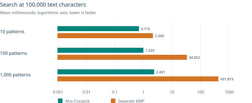

# Aho-Corasick Algorithm: Implementation and Experimental Comparison with KMP

Sultanali Baltabay | 14 November 2026 | Java bonus task

> AI-assisted technical report. This document does not replace the separate handwritten page, which must be written independently in the student's own words.

## 1. Objective

Implement Aho-Corasick in Java, find all occurrences of multiple patterns, and compare its build and search times with KMP run separately for each pattern. Evaluate the entire required input matrix with five measured repetitions and analyze time and space.

## 2. Implementation

The trie shares pattern prefixes. Terminal nodes retain original pattern IDs, including duplicate entries. Failure links are constructed by breadth-first traversal and identify the longest proper suffix that is also a trie prefix. Missing transitions are completed using the failure state. Output links point to the nearest terminal failure ancestor, avoiding inherited output-list copies. The search scans the text once, emitting terminal IDs and suffix outputs. The algorithm follows the finite-state approach introduced by Aho and Corasick [1].

The compressed alphabet contains the dictionary's distinct UTF-16 code units. Each state has a dense array over that alphabet; an unknown symbol resets the search to the root. Matching is exact and case-sensitive, with zero-based half-open UTF-16 offsets. Empty patterns are rejected. Empty texts and dictionaries return no results. The matcher is reusable.

For text `ahishers` and patterns `[he, she, his, hers]`, matches are `his [1,4)`, `she [3,6)`, `he [4,6)`, and `hers [4,8)`. The `he` match follows the output link from the `she` state. Overlapping matches are preserved.

The separate KMP implementation builds one prefix table per pattern and scans the full text for each pattern. After reporting a match it follows the last prefix value to preserve overlaps.

## 3. Correctness

The recorded run passed 3,108 assertions: 14 named input cases, explicit expected positions and counts, invalid-input and API checks, and 500 seeded random cases checked against an independent naive substring oracle. Coverage includes suffix outputs, overlaps, duplicates, Unicode, empty inputs, unknown characters, and repeated searches. Exact positions and pattern IDs are also compared between both algorithms for every benchmark input.

## 4. Methodology

The full 3 x 3 matrix uses 10, 100, and 1,000 distinct patterns with text lengths of 1,000, 10,000, and 100,000 UTF-16 code units. Patterns have lengths 3-12 and use lowercase Latin letters. Up to 20 patterns are injected into separate text segments. Every case has a recorded seed; inputs, exact-match validation, and file output are outside measured intervals. Before measurement there are 100 global warm-up rounds and 20 per case. Exactly five runs of each algorithm use System.nanoTime(). Run order alternates. Each run builds one matcher and searches one text. Both algorithms enumerate all matches through the same counting callback; they do not allocate a match list in the timed search. Arithmetic means use raw nanosecond values before rounding.

Recorded environment: Windows 11 amd64, 12 available logical processors; Oracle Corporation Java 25.0.1; Java HotSpot(TM) 64-Bit Server VM. CPU identifier: Intel64 Family 6 Model 151 Stepping 2, GenuineIntel. Recorded timestamp: 2026-11-14T03:09:24.677606900+05:00[Asia/Qyzylorda].

## 5. Complexity

Let k be the pattern count, M the total pattern length, S <= M + 1 the trie state count, sigma the distinct dictionary-symbol count, n the text length, and z the number of emitted occurrences. Alphabet-map lookups use expected constant time.

| Operation | Aho-Corasick (this implementation) | Repeated KMP |
| --- | --- | --- |
| Preprocessing | Expected O(M + S * sigma + k) | O(M + k) |
| Search | Expected O(n + z) | O(k * n + z) |
| Matcher auxiliary space | O(S * (sigma + 1) + k + sigma) | O(M + k) |
| Streaming search extra space | O(1) | O(1) |
| Collecting all matches | Additional O(z) | Additional O(z) |

The dense completed-transition table explains the S * sigma term. With a fixed alphabet, construction and matcher storage are linear in M + k. Output links store only O(k) direct terminal IDs instead of copying suffix outputs into descendants. The BFS queue requires O(S) temporary construction space. Add O(M) if retained dictionary characters are counted and O(n) for the input text itself. Build plus one search is expected O(M + S * sigma + k + n + z) for Aho-Corasick and O(M + k + k * n + z) for repeated KMP.

## 6. Measured results

| Patterns | Text length | AC search, ms | KMP search, ms | KMP / AC | Matches |
| --- | --- | --- | --- | --- | --- |
| 10 | 1,000 | 0.0778 | 0.0243 | 0.31x | 10 |
| 10 | 10,000 | 0.2803 | 0.2258 | 0.81x | 11 |
| 10 | 100,000 | 0.7153 | 2.2003 | 3.08x | 10 |
| 100 | 1,000 | 0.0077 | 0.2099 | 27.26x | 20 |
| 100 | 10,000 | 0.1398 | 3.6640 | 26.21x | 26 |
| 100 | 100,000 | 1.0198 | 34.0517 | 33.39x | 75 |
| 1,000 | 1,000 | 0.0177 | 2.6052 | 147.02x | 30 |
| 1,000 | 10,000 | 0.1392 | 29.0233 | 208.44x | 89 |
| 1,000 | 100,000 | 2.4313 | 431.8725 | 177.63x | 545 |

Search values are arithmetic means in milliseconds; KMP / AC divides the two means. All occurrences are enumerated, but full match objects are not materialized inside the timed section.

| Patterns | Text length | AC build, ms | KMP build, ms | AC total, ms | KMP total, ms |
| --- | --- | --- | --- | --- | --- |
| 10 | 1,000 | 0.0873 | 0.0015 | 0.1651 | 0.0258 |
| 10 | 10,000 | 0.0205 | 0.0013 | 0.3008 | 0.2271 |
| 10 | 100,000 | 0.0324 | 0.0025 | 0.7477 | 2.2028 |
| 100 | 1,000 | 0.0537 | 0.0032 | 0.0614 | 0.2131 |
| 100 | 10,000 | 0.1269 | 0.0087 | 0.2667 | 3.6726 |
| 100 | 100,000 | 0.1428 | 0.0107 | 1.1626 | 34.0625 |
| 1,000 | 1,000 | 0.6265 | 0.0440 | 0.6443 | 2.6492 |
| 1,000 | 10,000 | 1.0112 | 0.0441 | 1.1505 | 29.0674 |
| 1,000 | 100,000 | 0.8246 | 0.0666 | 3.2559 | 431.9391 |

Total means construction plus one search. Minima, maxima, and all five individual measurements are retained in the summary and raw CSV files.

## 7. Interpretation and limitations

For 1,000 patterns and 100,000 text characters, mean search time was 2.4313 ms for Aho-Corasick and 431.8725 ms for repeated KMP: a 177.63x search speedup on this input. Including construction, the observed speedup was 132.66x.

For the smallest case (10 patterns, 1,000 characters), KMP had the lower mean build-plus-search time. Aho-Corasick took 0.1651 ms and KMP took 0.0258 ms. Preprocessing therefore matters when choosing a matcher for short or one-off searches; a faster scan alone does not establish a faster complete operation.

The largest case has 5,957 states, alphabet size 26, and 154,882 transition slots. Their 32-bit integer payload is 605.0 KiB; KMP prefix-table integer payload is 29.1 KiB. These are derived payload sizes, not measured heap usage: objects, references, maps, lists, arrays' headers, the retained dictionary, and temporary construction allocations add memory.

The broad result is consistent with one shared text scan versus one scan per pattern. Individual timings need not be monotonic: the cases have different seeds, pattern lengths, alphabet sizes, and incidental matches, and the JVM and operating system add noise. These nine inputs and five samples per algorithm are not a statistical guarantee or a worst-case study.

Aho-Corasick is well suited to many fixed patterns and repeated text searches because the automaton shares prefixes and the text scan. KMP offers simpler preprocessing and smaller tables for one or a few patterns. Dense transition arrays become expensive for a large alphabet; rebuilding is required when the dictionary changes. Both approaches are exact-match algorithms and must account for output size when matches are frequent.

Only a single JVM process and five measured repetitions per case were used. Global and per-case warm-up reduce, but do not remove, JIT effects. Garbage collection, OS scheduling, CPU power management, and workload-dependent match density affect timings. There are no confidence intervals and no measured heap-profile results. The data support this local comparison, not a universal speedup claim.

## 8. Reproduction and submission

Run `powershell -ExecutionPolicy Bypass -File .\scripts\run.ps1 all` on Windows, or `bash scripts/run.sh all` on Linux/macOS with JDK 17+. Run `python scripts/build_report.py` with ReportLab and pypdf installed to regenerate this report after new measurements. Java has no third-party dependencies. Submit the GitHub repository URL through Moodle and independently prepare the required handwritten page.

## References

[1] A. V. Aho and M. J. Corasick. Efficient String Matching: An Aid to Bibliographic Search. Communications of the ACM, 18(6), 333-340, 1975. [Original paper](https://cr.yp.to/bib/1975/aho.pdf); [DOI](https://doi.org/10.1145/360825.360855).

[2] Oracle. Java SE 25: System.nanoTime(). [API documentation](https://docs.oracle.com/en/java/javase/25/docs/api/java.base/java/lang/System.html#nanoTime()). Use differences for elapsed time; nanosecond units do not imply nanosecond accuracy.
