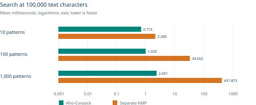

# Experimental results

All timings below are real local measurements, not estimates.

The full 3 x 3 matrix uses 10, 100, and 1,000 distinct patterns with text lengths of 1,000, 10,000, and 100,000 UTF-16 code units. Patterns have lengths 3-12 and use lowercase Latin letters. Up to 20 patterns are injected into separate text segments. Every case has a recorded seed; inputs, exact-match validation, and file output are outside measured intervals. Before measurement there are 100 global warm-up rounds and 20 per case. Exactly five runs of each algorithm use System.nanoTime(). Run order alternates. Each run builds one matcher and searches one text. Both algorithms enumerate all matches through the same counting callback; they do not allocate a match list in the timed search. Arithmetic means use raw nanosecond values before rounding.

## Search time

| Patterns | Text length | AC search, ms | KMP search, ms | KMP / AC | Matches |
| --- | --- | --- | --- | --- | --- |
| 10 | 1,000 | 0.0778 | 0.0243 | 0.31x | 10 |
| 10 | 10,000 | 0.2803 | 0.2258 | 0.81x | 11 |
| 10 | 100,000 | 0.7153 | 2.2003 | 3.08x | 10 |
| 100 | 1,000 | 0.0077 | 0.2099 | 27.26x | 20 |
| 100 | 10,000 | 0.1398 | 3.6640 | 26.21x | 26 |
| 100 | 100,000 | 1.0198 | 34.0517 | 33.39x | 75 |
| 1,000 | 1,000 | 0.0177 | 2.6052 | 147.02x | 30 |
| 1,000 | 10,000 | 0.1392 | 29.0233 | 208.44x | 89 |
| 1,000 | 100,000 | 2.4313 | 431.8725 | 177.63x | 545 |

KMP / AC is the ratio of mean search times, not the mean of per-run ratios. A value above 1 favors Aho-Corasick.

## Construction and one complete operation

| Patterns | Text length | AC build, ms | KMP build, ms | AC total, ms | KMP total, ms |
| --- | --- | --- | --- | --- | --- |
| 10 | 1,000 | 0.0873 | 0.0015 | 0.1651 | 0.0258 |
| 10 | 10,000 | 0.0205 | 0.0013 | 0.3008 | 0.2271 |
| 10 | 100,000 | 0.0324 | 0.0025 | 0.7477 | 2.2028 |
| 100 | 1,000 | 0.0537 | 0.0032 | 0.0614 | 0.2131 |
| 100 | 10,000 | 0.1269 | 0.0087 | 0.2667 | 3.6726 |
| 100 | 100,000 | 0.1428 | 0.0107 | 1.1626 | 34.0625 |
| 1,000 | 1,000 | 0.6265 | 0.0440 | 0.6443 | 2.6492 |
| 1,000 | 10,000 | 1.0112 | 0.0441 | 1.1505 | 29.0674 |
| 1,000 | 100,000 | 0.8246 | 0.0666 | 3.2559 | 431.9391 |

Total is construction plus one search. All times are milliseconds and each cell is a five-run arithmetic mean.

## Interpretation

For 1,000 patterns and 100,000 text characters, mean search time was 2.4313 ms for Aho-Corasick and 431.8725 ms for repeated KMP: a 177.63x search speedup on this input. Including construction, the observed speedup was 132.66x.

For the smallest case (10 patterns, 1,000 characters), KMP had the lower mean build-plus-search time. Aho-Corasick took 0.1651 ms and KMP took 0.0258 ms. Preprocessing therefore matters when choosing a matcher for short or one-off searches; a faster scan alone does not establish a faster complete operation.

The largest case has 5,957 states, alphabet size 26, and 154,882 transition slots. Their 32-bit integer payload is 605.0 KiB; KMP prefix-table integer payload is 29.1 KiB. These are derived payload sizes, not measured heap usage: objects, references, maps, lists, arrays' headers, the retained dictionary, and temporary construction allocations add memory.

The broad result is consistent with one shared text scan versus one scan per pattern. Individual timings need not be monotonic: the cases have different seeds, pattern lengths, alphabet sizes, and incidental matches, and the JVM and operating system add noise. These nine inputs and five samples per algorithm are not a statistical guarantee or a worst-case study.

## Evidence

- [90 raw measured runs](benchmark-runs.csv)
- [18 unrounded-to-milliseconds summaries, with search minima/maxima](benchmark-summary.csv)
- [9 dataset seeds and automaton sizes](datasets.csv)
- [Execution environment](environment.txt)
- [Correctness verification](verification.txt)
